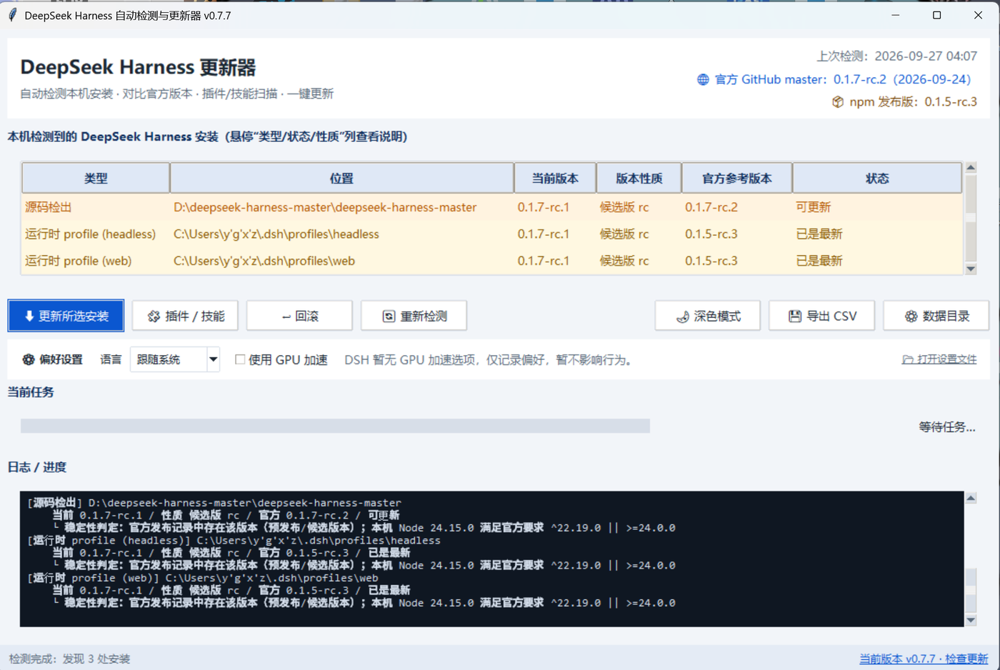
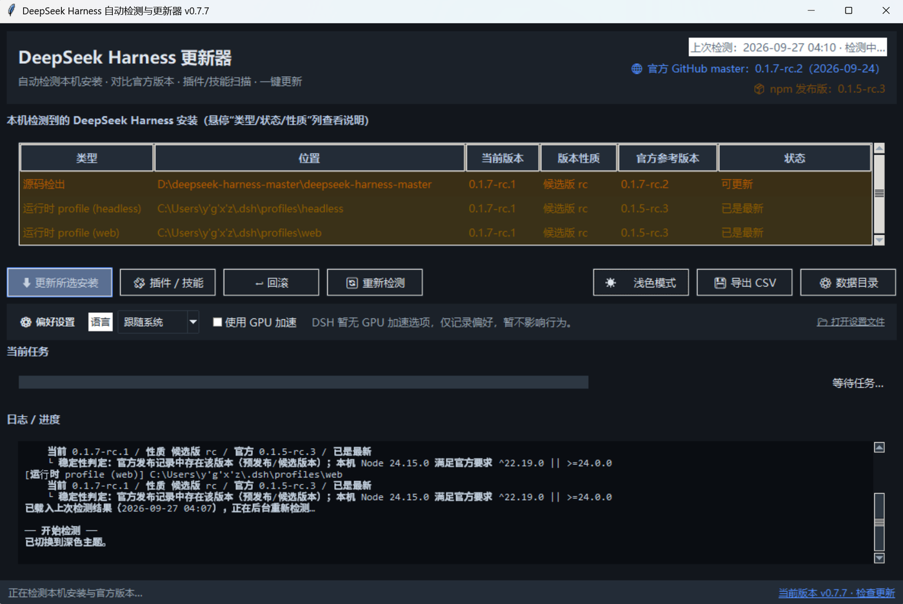
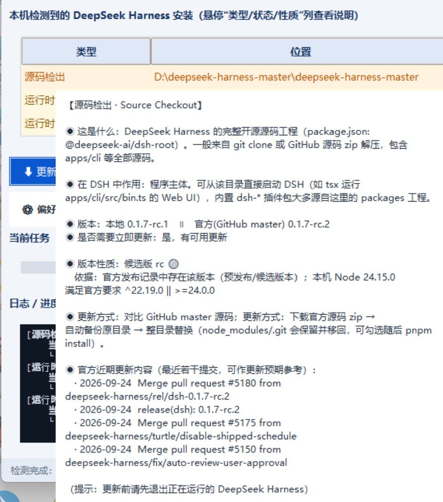
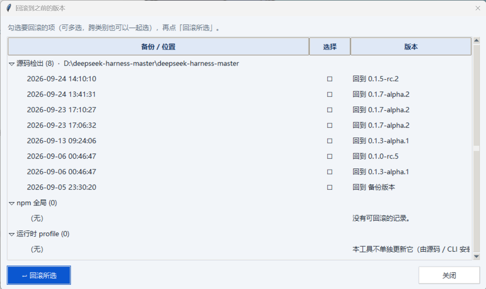
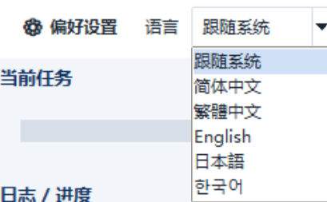
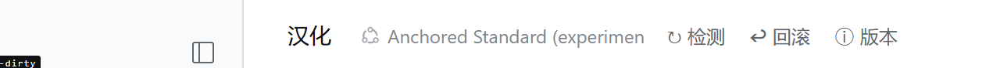
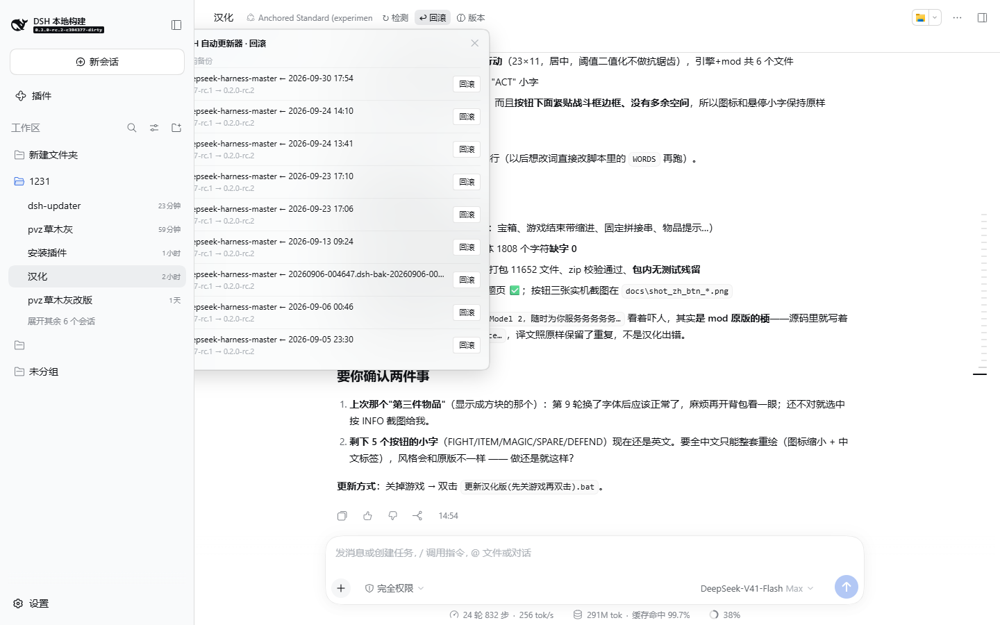
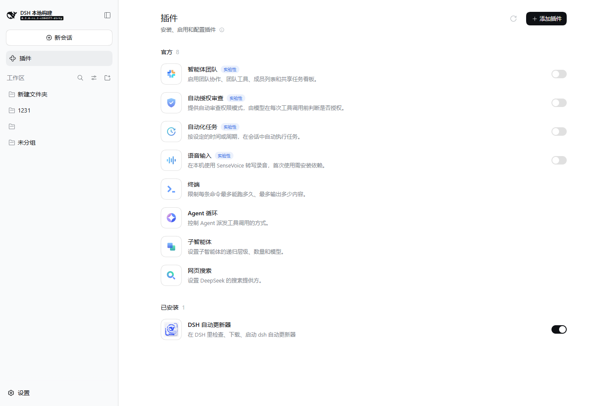

# DeepSeek Harness Updater

> English overview. The full documentation is in Chinese:
> [README.md](README.md) · [源码版更新与GitHub同步说明.md](源码版更新与GitHub同步说明.md)

A small Windows desktop tool that manages **DeepSeek Harness** installations on
your machine: detect what is installed, compare against the official release,
scan plugins/skills, update in one click, and keep local data safe.

**Two shapes, one implementation:**

| Shape | What it is | How to get it |
| --- | --- | --- |
| 🖥️ **Desktop app** | Standalone Windows program, no DSH required | [Download the EXE ↗](https://github.com/mutoharohfiqhiabcd-source/dsh-updater/releases/latest) |
| 🧩 **DSH web plugin** | Adds **Updater / Roll back / Version** buttons to every session header in the DSH web UI | `dsh plugin --profile web add github:mutoharohfiqhiabcd-source/dsh-updater` |

The plugin's buttons call this repository's `updater_core.py` — the desktop app
and the web plugin share one set of detection and rollback logic.

Repository: <https://github.com/mutoharohfiqhiabcd-source/dsh-updater> ·
DSH upstream: <https://github.com/deepseek-ai/deepseek-harness> ·
Announcement thread (DSH Discussions · Show Your Plugins!):
<https://github.com/deepseek-ai/deepseek-harness/discussions/9221>

---

## Screenshots

### 🖥️ Desktop app

| Main window (light) | Main window (dark) |
| --- | --- |
|  |  |

| Version-nature explanation | Rollback window |
| --- | --- |
|  |  |

<details>
<summary>One more: interface language switching (5 languages)</summary>



</details>

### 🧩 DSH web plugin

Three buttons appear in every session header (the row that already holds the
background-jobs chip):



| Roll back: every source backup, armed by a first press and executed by the second | The plugin card under Plugins → Installed |
| --- | --- |
|  |  |

> ⚠️ The plugin runs inside the DSH host process, **outside the workspace
> sandbox**: check, roll back, download and launch really touch the disk.

---

## Features

| Capability | Description |
|---|---|
| **Auto-detect** | Scans source checkouts, npm global installs and `.dsh` runtime profiles |
| **Version compare** | Source checkouts are compared against GitHub `master`; npm/profile against npm `latest` |
| **One-click update** | Source edition: download the official source zip → back up → replace the whole directory |
| **Local data kept** | `node_modules` and `.git` are preserved and moved back after the swap |
| **Plugin / skill scan** | Lists enabled plugins and skills under `.dsh\skills`, with sizes and install times |
| **Skill sync** | Runs `git pull --ff-only` for skills that have a `.git` directory |
| **Rollback** | Creates a `*.dsh-bak-<timestamp>` backup before updating; rolls back automatically on failure |
| **Multi-language** | 简体中文 / 繁體中文 / English / 日本語 / 한국어, auto-detected from the system language |
| **Detect-result cache** | Shows the previous scan result (with its timestamp) immediately on startup, then refreshes in the background |
| **Download source** | Opens an item's source (npm package page for plugins, git remote for skills) and remembers it for later update checks |

---

## Two editions

| | Source edition | EXE edition |
|---|---|---|
| How to start | Run `python updater_gui.pyw`, or double-click `启动更新器.bat` | Double-click `DeepSeekHarnessUpdater.exe` |
| Requirements | Python 3.10+ with tkinter | None |
| Best for | Reading/debugging the code, quick local tests | Handing to someone else |

Both are attached to every GitHub Release, together with `SHA256.txt` so you can
verify the download.

---

## Quick start

```bat
:: Source edition
python updater_gui.pyw

:: EXE edition — just double-click DeepSeekHarnessUpdater.exe
```

Requirements:

* **Updating DSH source:** DeepSeek Harness **must be closed** (the updater aborts
  if `127.0.0.1:3080` is in use).
* `pnpm` is optional — you can tick "run pnpm install after replacing" to sync
  dependencies.

---

## Install as a DSH plugin

This repository is also a **DSH plugin bundle** (`dsh.bundle` in `package.json`).
Once installed it appears under **Plugins → Installed** in the DSH sidebar and
gives the model a `dsh_updater` tool (`status` / `latest` / `notes` /
`download` / `launch`).

> Package name: `dsh-updater` on npm already belongs to a different, unrelated
> plugin, so this plugin's **npm package name is `dsh-updater-plugin`**. The
> repository name and the GitHub install spec are still `dsh-updater`.

**GUI:** sidebar → **Plugins** → **Add plugin** → enter either address below → **Install**.

**CLI (either one):**

```bat
:: from npm (since v0.9.0)
dsh plugin --profile web add dsh-updater-plugin

:: or from GitHub (this install spec never changed)
dsh plugin --profile web add github:mutoharohfiqhiabcd-source/dsh-updater
```

**Restart DSH once** afterwards. The plugin row hot-reloads, but upgrading a
version that is already loaded leaves the old Host half in the running process —
without a restart the buttons appear and then fail with 404.

### Three buttons in the session header

Once installed, every session's header (the row holding the background-jobs chip)
gains three buttons:

| Button | What it does |
| --- | --- |
| **↻ Updater** | Lists every local DSH installation (source checkout / npm global / runtime profile) with its version instantly, then fills in the upstream latest version and the update-available state asynchronously; **an updatable source checkout also gets an "Update" button (see below)** |
| **↩ Roll back** | Lists source backups, npm restore points and profile restore points; the first press arms *Confirm?* and the second performs it — the current directory is saved as a fresh backup first, so a rollback is itself reversible |
| **ⓘ Version** | Updater version, latest Release, local Python, local and archived EXEs, and every installation's version |

Updater and roll back are executed by this repository's `updater_core.py` (its new
`--json` mode), so they share the desktop app's logic. They need Python 3.10+ on
the machine; without it the panel says so and version info still works.

### Update DSH from the plugin

In the Updater panel, any row that is "Update available" gets an **Update** button
which opens an **in-plugin update dialog** (a replica of the desktop updater):

| In the dialog | Meaning |
|---|---|
| target / version | current version → upstream latest |
| ✅ close DSH automatically | the watcher ends DSH (only the PID owning the port) and restarts it afterwards |
| ☐ `pnpm install` after replacing | recommended when dependencies changed |
| ☐ `pnpm run build` after replacing | required when DSH is started from a source build |
| buttons | Start update / Close / **Use desktop updater** (still launches the EXE) |

With "close DSH automatically" the flow is: a **background worker** stages the
official source (the dialog shows a live progress bar:
`Downloading official source… 37% · 12.3 MB / 33.1 MB · 1.2 MB/s · 18s`, and you can
cancel while downloading) → watcher closes DSH → backs up the old folder → swaps the
new source (keeps `node_modules`/`.git`) → optional install/build → **restarts DSH** →
the page polls until DSH is back and **reloads itself**.

> Without auto-close you are asked to close DSH manually; the watcher then swaps,
> rebuilds and restarts. A download that takes more than 15 minutes fails with a
> clear timeout error instead of hanging forever. Safety: full backup, rollback on
> build failure, retry button when another process still occupies the folder (no
> re-download), and a cancel button while staging.

> Which rows get the **Update** button: **source checkouts**, and **runtime
> profiles whose runtime actually is a source checkout** (when
> `~/.dsh/profiles/node_modules/@deepseek-ai/dsh` is a junction into a checkout —
> that is the case on this machine, so the desktop / headless / web rows get the
> button too; any of them updates the same checkout). Plain npm-installed
> runtimes do not get the button.

> DSH's "Official" group only holds plugins shipped inside DSH itself; third-party
> plugins always land in "Installed", with no review or store submission.
> ⚠️ The plugin runs inside the DSH host process, **outside the workspace
> sandbox**; `download` / `launch` / `roll back` / `update DSH` really write files
> and start processes.

---

## Where local data is stored

Everything lives in a single "player preferences"-style file:

```
%APPDATA%\dsh-updater\preferences.json
├─ settings   your preferences (language, GPU toggle)
├─ cache      the previous scan result + timestamp
└─ sources    download sources you have opened and remembered
```

The file is written atomically. If it is missing, corrupted or has an unexpected
shape, the tool silently falls back to defaults — a broken file never blocks
startup. Older versions kept three separate files
(`settings.json` / `cache.json` / `sources.json`); they are migrated
automatically on first read and **the old files are left in place**.

You can point the tool at another directory with the
`DSH_UPDATER_SETTINGS_DIR` environment variable (useful for portable or test runs).

---

## Language switching

* The UI language is detected from the system language on first launch and can be
  changed in **Preferences → Language**.
* The interface is rebuilt immediately after switching — **no restart needed**.
* Switching language does **not** trigger a rescan: the previous result is reused.

> **Note:** if some text is still shown in a different language after switching,
> press **"🔄 Rescan"** to refresh the display. This only affects a few
> long log/tooltip strings that are built while scanning.

---

## Known limitations

* A few multi-line log messages are not yet translated and still show Chinese.
* **"Use GPU acceleration"** only records a preference — DSH does not expose a GPU
  acceleration option yet, so it currently has no effect.

---

## Repository layout

| File | Purpose |
|---|---|
| `updater_core.py` | Detection / version compare / download / update / skill sync |
| `updater_gui.pyw` | The Tkinter GUI |
| `i18n.py` + `i18n_*.py` | Multi-language framework and translation tables |
| `pack_source.py` | Builds the source-edition zip (used locally and in CI) |
| `启动更新器.bat` | One-click launcher for the source edition |
| `.github/workflows/ci.yml` | Static checks + smoke tests on push |
| `.github/workflows/build-release.yml` | Builds the EXE and publishes a Release on `v*` tags |
| `RELEASE_NOTES.md` | Release notes for the current version (used as the Release body) |
